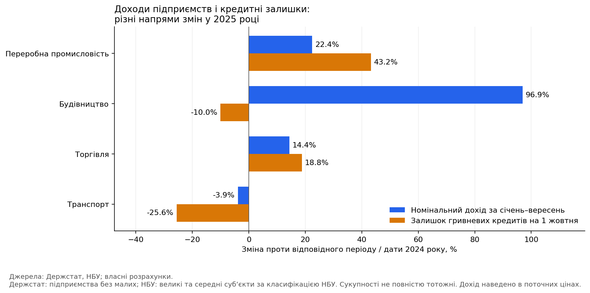
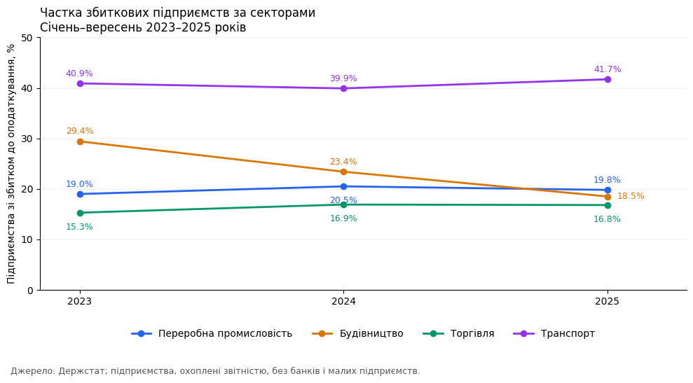
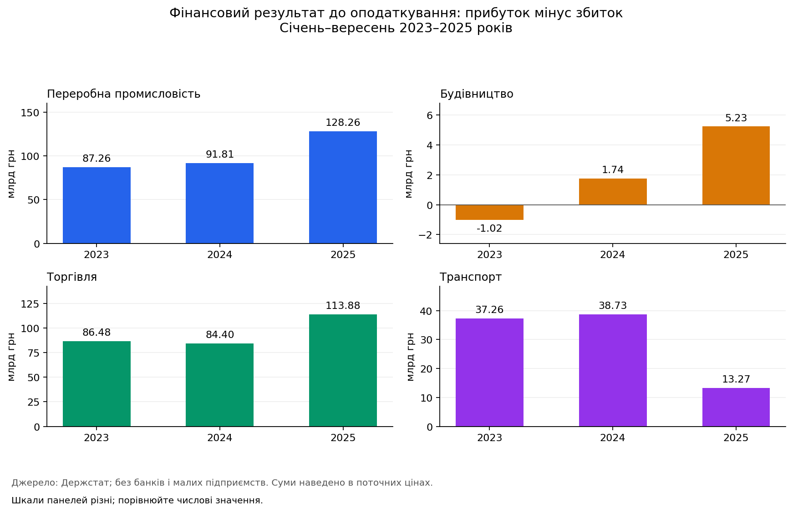
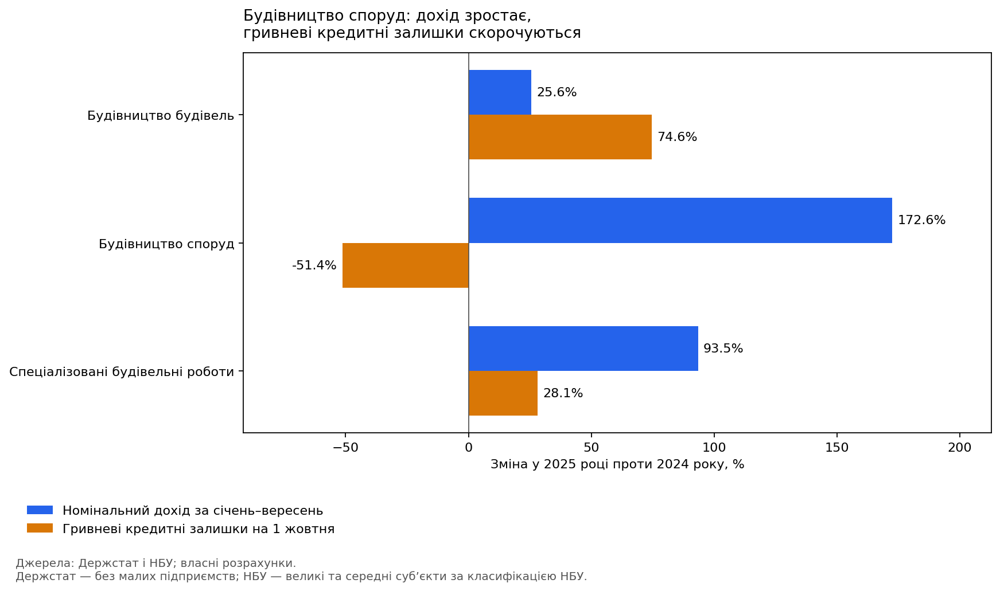

# Ділова активність і банківське кредитування в Україні

Аналіз чотирьох секторів економіки у 2023–2025 роках на основі даних Держстату та НБУ. Проєкт орієнтований на команду банківського кредитування бізнесу й визначає напрями для подальшого дослідження, а не кредитні рішення щодо окремих позичальників.

## Дослідницьке питання

Чи узгоджується динаміка кредитних залишків зі змінами доходів та фінансового стану підприємств? У яких секторах розходження потребує детальнішого пояснення?

Порівнюються переробна промисловість, будівництво, торгівля та транспорт. Дані Держстату охоплюють **січень–вересень** кожного року, а дані НБУ — залишки **станом на 1 жовтня**. 
## Основні результати

| Сектор | Зміна номінального доходу, 2025/2024 | Зміна гривневих кредитних залишків | Зміна частки збиткових підприємств |
|---|---:|---:|---:|
| Переробна промисловість | +22,44% | +43,24% | −0,70 в. п. |
| Будівництво | +96,93% | −10,04% | −4,90 в. п. |
| Торгівля | +14,38% | +18,75% | −0,10 в. п. |
| Транспорт | −3,88% | −25,60% | +1,80 в. п. |

**Головний результат:** скорочення гривневих кредитних залишків у будівництві та транспорті супроводжується різними фінансовими тенденціями. У будівництві показники охоплених підприємств покращуються, тоді як у транспорті погіршуються.

Деталізація будівництва показала, що **74,18% приросту доходу** сектору сформувало будівництво споруд. Водночас загальні кредитні залишки великих і середніх суб’єктів цього розділу скоротилися на **52,06%**. Зменшилися і гривнева, і валютна складові. Отже, перехід між валютами не пояснює скорочення портфеля на цих двох звітних датах.

## Дані та підготовка

- **Держстат:** [«Фінансові результати підприємств (квартальна)»](https://stat.gov.ua/uk/datasets/finansovi-rezultaty-pidpryyemstv-kvartalna), експорт `gov_dataset.csv`. Використано чистий дохід від реалізації, сальдо фінрезультату до оподаткування та частку підприємств зі збитком до оподаткування.
- **НБУ:** Excel-файли `Loans_MSE_KVED_2023-10-01.xlsx`, `Loans_MSE_KVED_2024-10-01.xlsx`, `Loans_MSE_KVED_2025-10-01.xlsx`, включно з аркушами методики. Джерело пошуку публікації — [офіційний сайт НБУ](https://bank.gov.ua/ua/statistic/supervision-statist). 

Основна таблиця містить **12 спостережень: 4 сектори × 3 роки**. Грошові суми в CSV наведено в млн грн, частки — у відсотках. Для графіків фінрезультату суми переведено в млрд грн.

Підготовка включає:

1. Відбір території «Україна», потрібних показників і однакових накопичувальних періодів Q3. Q3 означає січень–вересень, а не окремий третій квартал.
2. Збереження вихідних метаданих і видалення лише повністю однакових записів. Пропуски не заповнюються нулями або інтерполяцією.
3. Перевірку відсутності пропусків і повторів аналітичного ключа у фінальній вибірці.
4. Відбір великих і середніх суб’єктів НБУ; зіставлення розділів 10–33, 41–43, 45–47 та 49–53 із секціями C, F, G і H.
5. Перевірку валютних підсумків і об’єднання за сектором та роком з `validate='one_to_one'`.
6. Розрахунок річних темпів, змін часток у відсоткових пунктах та абсолютної зміни фінрезультату.

На етапі дослідження всього експорту за 2023–2025 роки виявлено 19 006 повністю однакових зайвих записів у довгому форматі та 554 ключі з різними значеннями. Конфлікти стосувалися трьох інших деталізованих видів діяльності. Відібрані широкі сектори та використані розділи будівництва перевірено окремо; суперечливі записи не усереднювалися й не відбиралися довільно.

## Результати

### 1. Доходи й кредитні залишки



У будівництві дохід зріс на 96,93%, а гривневі кредитні залишки зменшилися на 10,04%. У транспорті обидва показники скоротилися. Різниця темпів є описовим сигналом, а не оцінкою незадоволеного попиту на кредити.

### 2. Поширеність збитковості



У будівництві частка збиткових підприємств знизилася з 29,41% до 18,50% за 2023–2025 роки. Транспорт мав найвищу частку серед чотирьох секторів у кожному році; у 2025 році вона становила 41,70%. Показник характеризує кількість підприємств, а не вагу їхніх збитків.

### 3. Фінансовий результат



**Шкали панелей різні: порівнюйте числові значення.** Будівництво перейшло від сальдо −1,02 млрд грн у 2023 році до +5,23 млрд грн у 2025 році. У транспорті сальдо залишилося додатним, але скоротилося приблизно на 65,7% проти 2024 року — до 13,27 млрд грн. Сукупний прибуток не означає, що всі підприємства сектору прибуткові.

### 4. Де зосереджене розходження в будівництві



| Розділ | Приріст доходу, млн грн | Внесок у приріст доходу будівництва | Зміна гривневих кредитів |
|---|---:|---:|---:|
| 41 — Будівництво будівель | 11 291,25 | 11,49% | +74,60% |
| 42 — Будівництво споруд | 72 925,38 | 74,18% | −51,39% |
| 43 — Спеціалізовані будівельні роботи | 14 090,03 | 14,33% | +28,14% |

Сума доходів трьох розділів узгоджується з підсумком будівництва за обидва роки. Скорочення гривневих кредитів розділу 42 частково компенсувалося зростанням у розділах 41 і 43.

**Перевірка валютного пояснення, розділ 42:**

| Кредитні залишки, млн грн | 01.10.2024 | 01.10.2025 | Зміна |
|---|---:|---:|---:|
| Гривневі | 3 357,55 | 1 632,14 | −51,39% |
| Валютні у гривневому еквіваленті | 91,30 | 21,38 | −76,59% |
| Усього | 3 448,84 | 1 653,51 | −52,06% |

Валютна складова не компенсувала скорочення гривневої. Її динаміка у гривневому еквіваленті також включає валютну переоцінку.

## Практичне значення для банку

1) **Будівництво споруд:** перевірити джерела фінансування, погашення, нові видачі та кредитні заявки. Зростання доходу саме по собі не доводить потреби в додаткових банківських кредитах.
2) **Транспорт:** деталізувати погіршення за підгалузями та позичальниками; перевірити грошові потоки, боргове навантаження й концентрацію ризику.
3) **Промисловість:** дослідити, чи супроводжується швидше зростання кредитних залишків покращенням здатності обслуговувати борг.
4) **Торгівля:** перевірити, наскільки зростання сукупного фінрезультату поширене між підприємствами, адже частка збиткових майже не змінилася у 2025 році.

## Обмеження

1) Дохід і фінрезультат номінальні; зростання фізичного обсягу діяльності не оцінювалося.
2) Держстат виключає малі підприємства. НБУ використовує власну класифікацію розміру суб’єктів; сукупності не повністю тотожні. Співвідношення кредитів до доходу не подається як точне боргове навантаження.
3) Воєнні зміни територіального охоплення, повноти звітності та складу підприємств можуть впливати на динаміку. Причини зростання доходу будівництва споруд ще не встановлені.
4) Кредитні залишки не розділяють нові видачі, погашення, списання та перекласифікації. Висновки про причини або незадоволений попит із них не випливають.
5) У 2023–2024 роках колонки 7–9 НБУ містять NPL за Положенням №351. У 2025 році це дефолтні кредити, а NPL за Положенням №97 містяться в колонках 10–12. Код зберігає `npl_definition`; наскрізна динаміка NPL не інтерпретується.
6) Три річні зрізи не дають підстав для надійного прогнозування чи причинних висновків.

## Структура

```text
notebooks/gov_data.ipynb        # послідовний аналіз із поясненнями
src/prepare_nbu.py             # підготовка НБУ та перевірка об’єднання
data/README.md                # джерела, файли та словник даних
data/raw/                     # локальні оригінали, виключені з Git
data/processed/               # чотири підсумкові CSV
reports/figures/               # чотири графіки для README
requirements.txt
.gitignore
```

## Відтворення

Потрібен Python 3.10+ і чотири вихідні файли, перелічені в [описі даних](data/README.md).

```bash
git clone https://github.com/fiki4/ua_credit_gov_analysis.git
cd ua_credit_gov_analysis
python -m venv .venv
```

Активуйте середовище (`.venv\Scripts\Activate.ps1` у PowerShell або `source .venv/bin/activate` у Linux/macOS), потім:

```bash
python -m pip install -r requirements.txt
python -m jupyterlab
```

