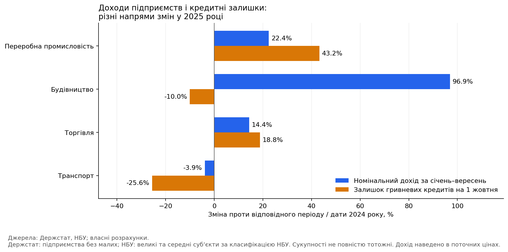
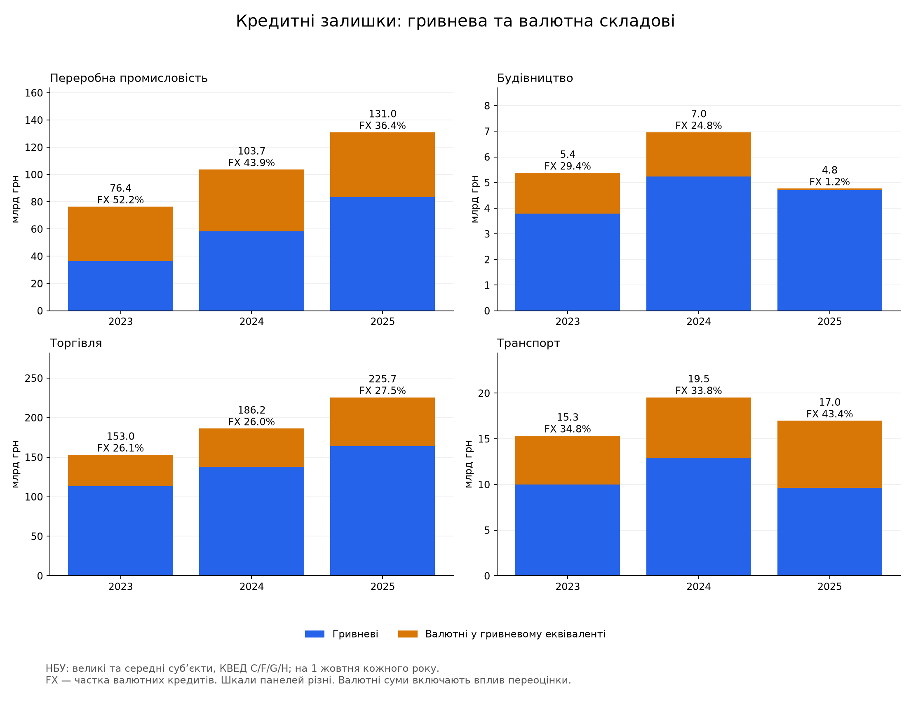
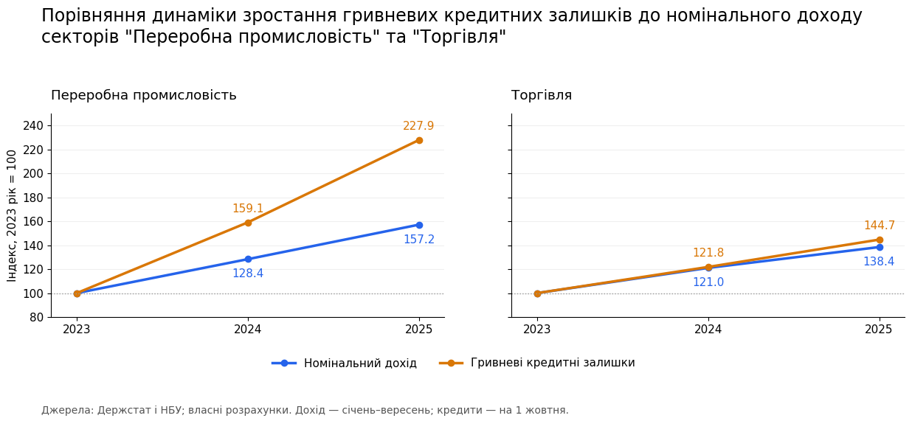
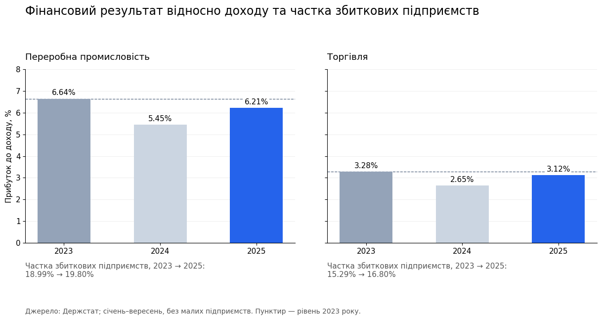
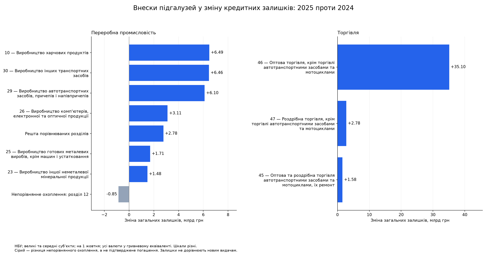
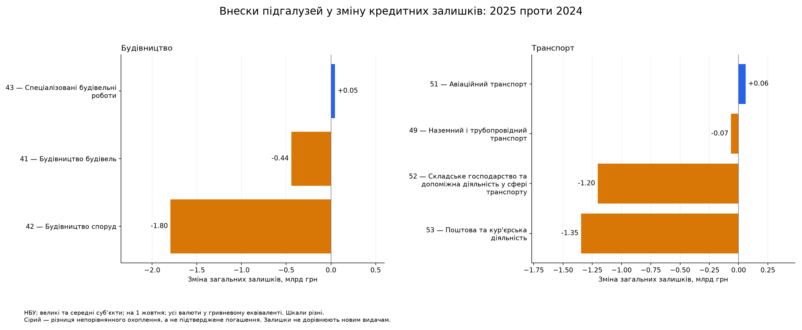
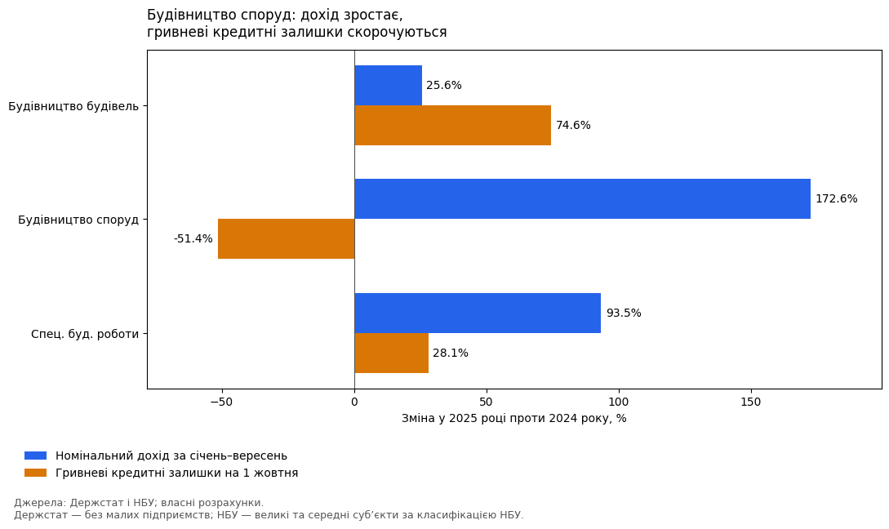
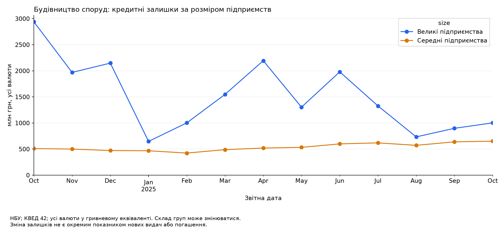

# Поглиблений аналіз кредитування чотирьох секторів України

[← Повернутися до основного опису проєкту](../README.md)

# Ділова активність і банківське кредитування в Україні

Аналіз чотирьох секторів за даними Держстату та НБУ у 2023–2025 роках. Мета — визначити, де зміни фінансових показників і кредитних залишків потребують детальнішого дослідження банком.

**Головний результат:** тенденції суттєво відрізняються за валютами, розміром підприємств і підгалузями. Секторні агрегати допомагають обрати напрям перевірки, але не доводять дефіциту кредитів або причин зміни заборгованості.

## Період і охоплення

- Держстат: доходи, сальдо фінрезультату до оподаткування та частка збиткових підприємств за січень-вересень; малі підприємства виключені.
- НБУ: кредитні залишки на 1 жовтня, великі й середні суб’єкти за класифікацією НБУ. Додатково - місячні зрізи будівництва споруд.
- Сектори: переробна промисловість (C), будівництво (F), торгівля (G), транспорт (H).
- Охоплення джерел не повністю тотожне. Кредити - залишки на дату, не обсяг нових видач. Валютні суми наведено у гривнях.

## Основні результати

Зміни 2025 року проти відповідного періоду/дати 2024 року:

| Сектор | Номінальний дохід | Гривневі кредити | Кредити в усіх валютах | Частка збиткових, зміна |
|---|---:|---:|---:|---:|
| Промисловість | +22,44% | +43,24% | +26,31% | −0,70 в. п. |
| Будівництво | +96,93% | −10,04% | −31,51% | −4,90 в. п. |
| Торгівля | +14,38% | +18,75% | +21,19% | −0,10 в. п. |
| Транспорт | −3,88% | −25,60% | −13,08% | +1,80 в. п. |

Промисловість зберігає випереджальне зростання кредитних залишків після врахування валют, але розрив із доходом значно менший. У торгівлі приріст переважно зосереджений в оптовому напрямі. У будівництві скорочення кредитів супроводжується покращенням секторних фінансових показників, у транспорті - їх погіршенням.

## 1. Валютна перевірка змінює масштаб висновків

Початкове порівняння стосується лише гривневих кредитів. Для оцінки всього портфеля додаємо валютну складову.

| Сектор | Зміна валютних залишків, 2025/2024 | Валютна частка 2024 | Валютна частка 2025 |
|---|---:|---:|---:|
| Промисловість | +4,68% | 43,91% | 36,39% |
| Будівництво | −96,71% | 24,77% | 1,19% |
| Торгівля | +28,13% | 25,97% | 27,45% |
| Транспорт | +11,42% | 33,82% | 43,35% |

Зростання валютних залишків частково компенсувало падіння гривневих у транспорті. У будівництві врахування валют, навпаки, посилює скорочення. Зміни валютних сум включають переоцінку й не доводять переоформлення кредитів конкретними позичальниками.

Дані: [залишки за три роки](../data/processed/sector_balances.csv), [абсолютні й відносні зміни](../data/processed/sector_changes.csv).

## 2. Промисловість і торгівля

За 2023–2025 роки гривневі залишки промисловості зросли на 127,87%, загальні — на 71,39%, дохід — на 57,15%. У торгівлі загальні залишки зросли на 47,45%, дохід — на 38,44%. Індекси не є оцінкою боргового навантаження.

В обох секторах відношення сальдо фінрезультату до доходу у 2025 році покращилося проти 2024, але залишилося нижчим за рівень 2023 року. Частка збиткових також вища, ніж у 2023 році. Це аналітичне співвідношення, не офіційний показник рентабельності Держстату.

Найбільші додатні внески промисловості у 2025 році: харчові продукти **+6,49 млрд грн**, інші транспортні засоби **+6,46 млрд грн**, автотранспортні засоби та причепи **+6,10 млрд грн**. Це концентрація за видами діяльності, не за окремими позичальниками; призначення кредитів не встановлено.

В оптовій торгівлі залишки зросли на **35,10 млрд грн** — **88,96% чистого приросту** торговельного сектору.

**Обмеження:** розділ 12 (тютюнові вироби) мав 0,85 млрд грн у 2024 році, але відсутній у вибірці великих і середніх за 2025 рік. Залишковий внесок показано окремо сірим. Відсутність рядка не прирівнюється до нульового боргу й не доводить погашення. Секторні суми є сумами доступних опублікованих записів.

## 3. Будівництво і транспорт

У будівництві споруд загальні залишки скоротилися на **1,80 млрд грн**, будівництві будівель — на **0,44 млрд грн**. У будівництві будівель гривнева складова зростала, але падіння валютної перевищило цей приріст.

У транспорті головні від’ємні внески: поштова та кур’єрська діяльність **−1,35 млрд грн**, складське господарство та допоміжна діяльність **−1,20 млрд грн**. Їхній внесок у зміну фінрезультату сектору окремо не встановлено.

### Детальна перевірка будівництва споруд

Дохід КВЕД 42 зріс на **172,59%**, сформувавши **74,18% приросту доходу будівництва**. Загальні кредитні залишки скоротилися з 3,45 до 1,65 млрд грн (**−52,06%**). Обидві валютні складові зменшилися.

Між жовтневими датами залишки великих підприємств скоротилися приблизно на **65,9%**, середніх — зросли на **27,8%**. Місячна динаміка нерівномірна, тому твердження про безперервне падіння було б некоректним.

### Перевірка стійкості до вибору дат

Середнє арифметичне дев’яти зрізів після завершення місяців січня–вересня (файли на 1 лютого — 1 жовтня):

| Група | 2024, млн грн | 2025, млн грн | Зміна |
|---|---:|---:|---:|
| Великі | 2 237,00 | 1 332,17 | −40,45% |
| Середні | 424,40 | 560,52 | +32,07% |
| Разом | 2 661,40 | 1 892,69 | −28,88% |

Скорочення зберігається, але є меншим за жовтневі −52,06%. Це не середньоденний борг і не нові видачі. [Таблиця перевірки](../data/processed/average_42_comparison.csv).

### Перевірка категорій розміру

Між 01.12.2024 і 01.01.2025 залишки великих підприємств КВЕД 42 зменшилися на **1,50 млрд грн** — 97,27% чистого скорочення за всіма сімома категоріями. Співмірного збільшення в інших групах виявлено не було.

Це окрема, ширша вибірка з малими, мікропідприємствами й «Іншими». Агрегати не виключають перекласифікацій, компенсованих іншими операціями, або переходів між видами діяльності. [Таблиця категорій](../data/processed/size_transition_42_comparison.csv).

## 4. Що робити банку далі

| Сегмент | Наступна перевірка | Чого ще не встановлено |
|---|---|---|
| Великі позичальники КВЕД 42 | Видачі, погашення, списання та зміни складу клієнтів, особливо за грудень 2024 | Причину падіння залишків і наявність незадоволеного попиту |
| Промисловість, КВЕД 10/29/30 | Призначення кредитів і грошові потоки позичальників | Чи є збільшення боргу надмірним |
| Оптова торгівля, КВЕД 46 | Оборотність запасів, дебіторську заборгованість, концентрацію портфеля | Потребу в автоматичному розширенні кредитних лімітів |
| Транспорт, КВЕД 52/53 | Фінансовий стан клієнтів і причини змін заборгованості | Причинний зв’язок зі зниженням фінрезультату всього сектору |

Рішення щодо продуктів, умов і лімітів потребують даних конкретних клієнтів. Проєкт визначає пріоритети перевірки, а не універсальну кредитну політику.

## Методика та обмеження

- Джерело Держстату: [фінансові результати підприємств (квартальна)](https://stat.gov.ua/uk/datasets/finansovi-rezultaty-pidpryyemstv-kvartalna). Джерело НБУ — файли `Loans_MSE_KVED_YYYY-MM-DD.xlsx` та їхні аркуші методики. 
- Фінальна вибірка не використовує інтерполяцію чи заповнення пропусків нулями. Видалено лише повні повтори; перевірено ключі, пропуски, одиниці, валютні суми та об’єднання `one_to_one`.
- Q3 означає січень–вересень. Накопичувальні квартальні суми не додаються між собою.
- Дохід номінальний; зростання фізичного обсягу діяльності не оцінювалося.
- Охоплення джерел відрізняється. Воєнні зміни територій, складу й повноти звітності можуть впливати на динаміку.
- Кредитні залишки не розділяють нові видачі, погашення, списання та перекласифікації. Валютні суми включають переоцінку.
- Визначення NPL змінилося у 2025 році; його наскрізна динаміка не використовується як однорідний ряд.
- Причини різкого зростання доходу будівництва споруд не встановлені. Аналіз описовий, не причинний.

## Подальші (потенційні) майбутні дослідження

1. Перевірити причину відсутності КВЕД 12 у вибірці 2025 року.
2. Зіставити кредитні зміни з фінансовими результатами відповідних підгалузей.
3. Додати порівнянні показники балансів і джерел фінансування інвестицій.
4. Використати дані банку про позичальників і потоки для пояснення конкретних змін.
